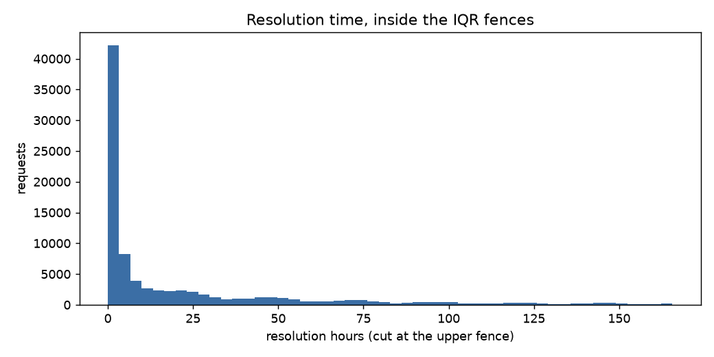
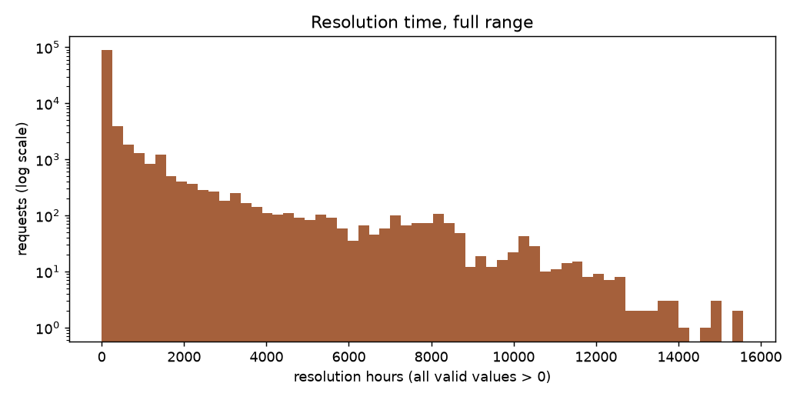
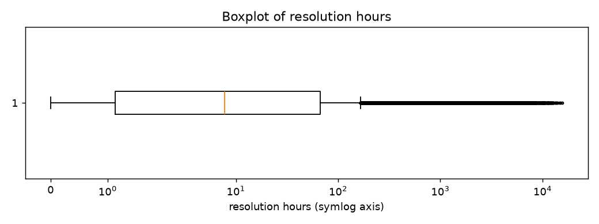
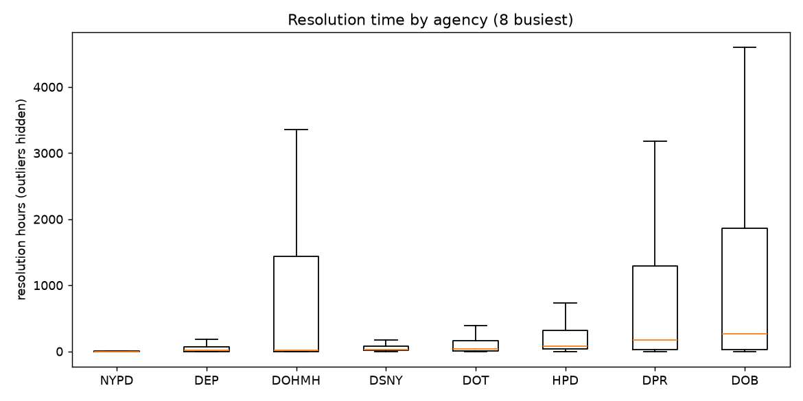

# Statistical check: resolution_hours

Valid resolution durations: **104,115** (closed requests where the closed date is not before the created date).

## Central tendency and spread

| Statistic | Hours |
|---|---|
| Mean | 261.79 |
| Median | 7.80 |
| Mode (whole hours) | 1 |
| Minimum | 0.00 |
| Maximum | 15,567.6 |
| Range | 15,567.6 |
| Q1 / Q3 | 1.13 / 66.94 |
| IQR | 65.81 |
| Variance | 1,016,215 |
| Standard deviation | 1,008.1 |
| 90th / 95th / 99th percentile | 435.0 / 1,427.2 / 5,760.7 |

## Shape

Skewness is **6.66** and excess kurtosis is **53.0**, so the distribution is strongly right-skewed with a very heavy tail.
The mean (261.8 h) is far above the median (7.8 h): a few very long cases pull the mean up, so the median is the fairer "typical" value.

## IQR outlier screen

- Lower fence: Q1 - 1.5 x IQR = -97.58 h (below zero, so no value can fall under it)
- Upper fence: Q3 + 1.5 x IQR = 165.65 h
- Above the upper fence: **16,547** requests (15.9% of valid durations)

These are flags for a closer look, not rows to delete. Long cases such as building repairs or tree work can be real.
Share of valid durations over the project's 72-hour line: 23.9%.

## Other numeric fields

|       |    latitude |   longitude |   created_hour |
|:------|------------:|------------:|---------------:|
| count | 103892      | 103892      |    105540      |
| mean  |     40.74   |    -73.9212 |        13.1348 |
| std   |      0.0882 |      0.0759 |         6.1675 |
| min   |     40.4989 |    -74.2531 |         0      |
| 25%   |     40.6745 |    -73.9647 |         9      |
| 50%   |     40.7319 |    -73.9239 |        13      |
| 75%   |     40.8216 |    -73.8709 |        18      |
| max   |     40.9129 |    -73.7007 |        23      |

## Charts

